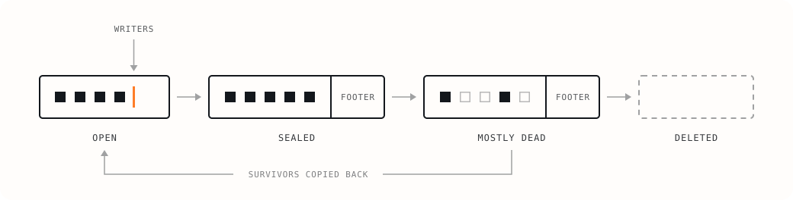

# tape-reel

Reel is a key-value store and the default storage engine for Tapedrive storage nodes.

<!-- CHART: assets/reel-vs-rocksdb.svg, redrawn from the final rows. Its caption says reel's scans were told their row count and
RocksDB's iterators were not, and that the 50M rows run under an 8 GiB memory cap that holds LMDB, redb and partly RocksDB to
the disk. No numbers until the final rows. -->

## How it works

Reel stores everything in large files called segments and only ever appends to them. A segment takes writes while it's open
and is sealed once it's full or has sat quiet. Its records die as their keys are overwritten or deleted, and cleanup deletes the segment once it
has copied out the records still alive.

### Memory

Reel takes one memory budget when it opens and holds its whole heap inside it: the index of keys not yet sealed, the caches,
each segment's block index, the buffers every thread reads and writes through, and any index a column declares. It sizes each
part from the budget and writes every page before open returns, so once the store is open, gets, puts and scans allocate
nothing. A budget too small for what the columns declare is refused at open with the least budget that would do.

### Writing

A write goes onto the end of whichever open segment is least busy. Several segments are open at once, so writers don't queue
behind each other. When a segment fills up, or sits quiet for a while, reel seals it by writing a sorted index of its contents at the end
of the file, called the footer. After that the segment never changes. A batch of writes lands as one unit, so after a crash
either the whole batch is there or none of it is. Reel has no separate log in front of the data, because the segments themselves
are the log.

### Finding a key

Keys in open segments sit in an in-memory index. For keys in sealed segments a column can declare one of two indexes, and the
budget pays for it:

- A complete table holds a slot for every key by hash, for a column that is only read by key.
- A sorted index holds every key's newest place in key order, for a column that is also scanned. Its keys are one fixed width.

A column with neither searches the footers of the sealed segments, skipping any whose key range or filter rules the key out.
Either way, one disk read usually fetches the value. The files are the source of truth, so reel can rebuild every index from
them when it opens.

A clean close saves each declared index to a file beside the segments, and the next open reads it back in place of the
rebuild. A file that no longer matches the segments, or a store that wasn't closed cleanly, falls back to the rebuild.

### Walking keys in order

Segments are in the order things were written, so any key can sit in any segment. On a column with a sorted index a scan takes
its keys from the index in runs and reads their values together. On any other column it merges the footers of every segment
that holds part of its range, and cleanup keeps the number of segments over any key under a bound so that merge stays short.
A caller can tell a scan how many rows it will take, and the scan then locates and reads only that many at a time.

### Deleting

Nothing changes in place, so a delete appends a small marker called a grave, which says the key is gone, and a range delete
appends one marker over a whole range. The old values and the markers stay on disk until cleanup reaches them.

### Cleanup

Cleanup runs on reel's own worker threads, at a lower priority than the callers:

- A walk reads each sealed segment's rows and counts how much of it is dead, meaning overwritten or deleted.
- A wholly dead segment is deleted outright, which costs almost nothing.
- A mostly dead segment has its surviving records copied out, and then the old file is deleted.
- Where too many segments cover one key, a merge folds some of them into one.
- Graves are dropped during a copy once nothing older can come back.

## What it's good at

Reel works best when data is written once and expires in whole groups, as a storage node's slices do. Whole segments go dead
together and get dropped for free. It writes each value once and moves it again only when cleanup copies a mostly dead segment or
merges segments that cover the same keys. It's weaker when the same keys get written and deleted
over and over. The waste then spreads across segments that stay mostly alive, so cleanup either copies a lot or waits.

## Limits

A sorted index takes keys of one fixed width, and a column has one index kind, sorted or complete. A sorted index is sized at
each open from the keys it held: twice them with 256 MiB past, out of the block, spot and record caches, which keep a quarter of
their room. A complete table holds the rows its column declared. Rows past an index's room mark it, and from then on gets and
scans of that column read the footers until the store is opened again with room for them. A marked index saves no file at
close. The maintenance report shows each index's rows, room and mark, and the bytes a sorted index asked for and got, so an
index about to fill shows before it does and a budget too small for it shows why. A count of the keys under a prefix reads
the segments, with or without a sorted index. A damaged segment that held range deletes stays damaged until someone clears
it, since reel can't tell what those deletes hid once their footer is gone.

## More

The API is documented on [docs.rs](https://docs.rs/tape-reel). Licensed under Apache-2.0. See [LICENSE](LICENSE).

<!-- AT RELEASE: the chart from release-build rows only (reel with no test hooks, every engine on the system allocator), each
row saying the store's state, quiet after a restart or with a writer at 20k puts a second, 2 GiB of cache for every engine and THP
always. No sorted row whose status is past_capacity. Told rows say so in the caption. "What it's good at" gains the trade as
the final rows measure it. If the refill ships, "until the store is opened again with room for them" in Limits changes. -->
