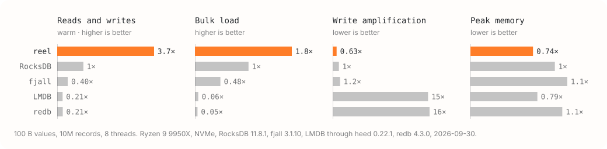

# tape-reel

Reel is a key-value store and the default storage engine for Tapedrive storage nodes. Its core rule
is that data only gets appended to the end of a file and is never changed in place.

## Writing

The store is a set of large files called segments. A write goes onto the end of whichever open
segment is least busy. Several segments are open at once, so writers don't queue behind each other.
When a segment fills up, reel seals it by writing a sorted index of its contents at the end of the
file, called the footer. After that the segment never changes. A batch of writes lands as one unit,
so after a crash either the whole batch is there or none of it is. Reel has no separate log in front
of the data, because the segments themselves are the log.

## Finding a key

Reel keeps an index in memory that says which segment and position holds each key. Keys in open
segments sit in an in-memory tree, and keys in sealed segments are tracked in a compact lookup
table. When the table can't answer, reel searches the footers of the sealed segments. It skips any
segment whose key range or filter rules the key out. Either way, one disk read usually fetches the
value. The files are the source of truth, so reel can rebuild the whole index from them when it
opens.

## Walking keys in order

Scans and prefix lookups need keys in sorted order. Segments are in the order things were written,
so any key can sit in any segment, and a scan has to merge the footers of every segment that might
hold part of its range. That gets slower as segments pile up. To keep it in check, reel merges
footers in the background into key runs, which are sorted lists of keys that point back to where
each record lives. A scan then has far fewer lists to merge. Only the keys get merged. Values stay
where they were first written.

## Deleting

Nothing changes in place, so a delete appends a small marker called a tombstone, which says the key
is gone. The old value and the tombstone both stay on disk until cleanup reaches them, and a scan
that runs into them has to step over them.

## Cleanup

The store's owner calls `maintain_once` about once a second, and each call runs one maintenance
pass. A pass tracks how much of each segment is dead, meaning overwritten or deleted:

- A fully dead segment is deleted outright, which costs almost nothing.
- A mostly dead segment has its surviving records copied into an open segment, and then the old
  file is deleted.
- Reel waits until a segment is about half dead before it bothers. It lowers that bar once the store
  as a whole is carrying a lot of waste.
- Tombstones get dropped during the copy once nothing older can come back.

## Other pieces

One process owns a store for writing. Other processes can open it read-only, which is how the `reel`
CLI inspects a store while it's in use. A snapshot of the store is a set of hard links to sealed
files.

## What it's good at

Reel works best when data is written once and expires in whole groups, as a storage node's slices
do. Whole segments go dead together and get dropped for free. Compared with RocksDB, reel writes
each value once and sorts only the keys, so it does far fewer disk writes. It's weaker when the same
keys get written and deleted over and over. The waste then spreads across segments that stay mostly
alive, so cleanup either copies a lot or waits.

## More

The design notes live in [crates/reel/docs](crates/reel/docs/README.md), starting at
[overview.md](crates/reel/docs/overview.md). Licensed under Apache-2.0. See [LICENSE](LICENSE).
